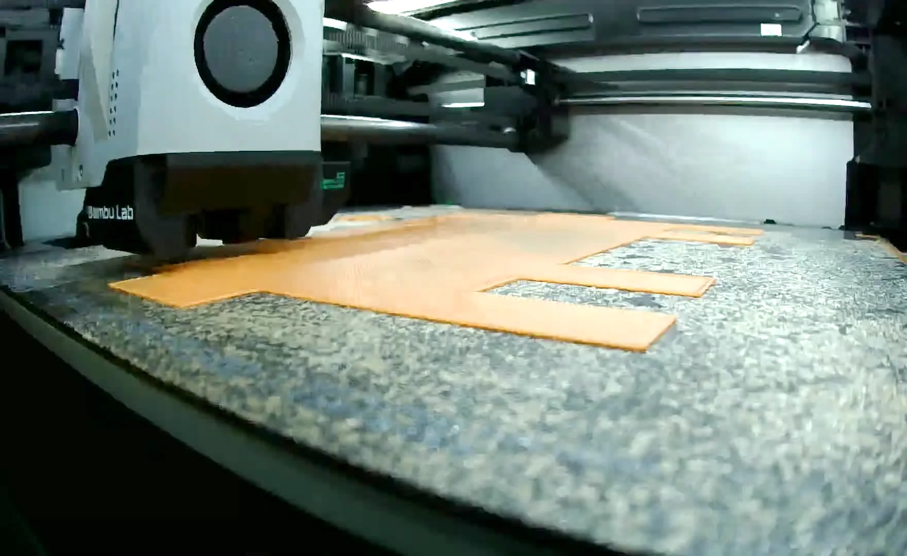
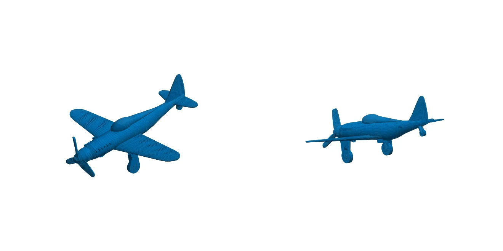
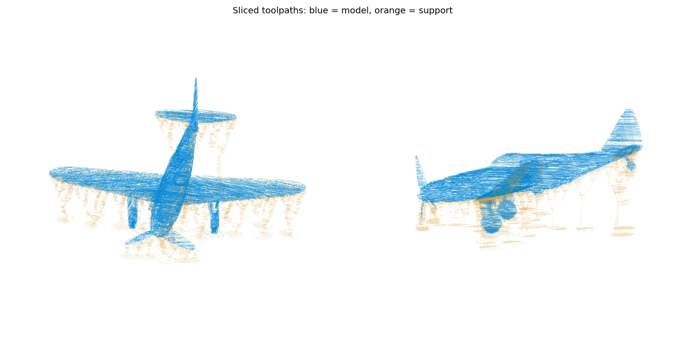

# PrintPulse Bambu MCP

PrintPulse brings a Bambu Lab printer into an MCP client running on the same Windows PC. The server reads printer status and camera frames, prepares and slices models with the local Bambu Studio install, checks a print before sending it, and monitors the job.

This is a local integration, not a hosted printer service. Printer access, model files, and slicing stay on your machine. Sending a print goes through Bambu's installed software and requires a fresh preflight, visual review, and explicit confirmation.

## What it can do

- List configured printers and read live job, temperature, layer, and AMS status.
- Capture fresh frames from the printer camera.
- Inspect model dimensions and orientation options; prepare and slice models in Bambu Studio.
- Check the sliced job against printer, plate, nozzle, filament, and current machine status.
- Require a recent passing check, camera review, and user confirmation before sending a print; confirm the job actually starts and monitor it.

The checked-in printer profile demonstrates an X1 Carbon setup. The server also contains an H2C send path through Bambu Connect. Hardware and send-path behavior depend on the locally installed Bambu software and the printer/account setup.

## What you need

- Windows and Python 3.12 or newer
- [`uv`](https://docs.astral.sh/uv/)
- Bambu Studio installed locally (used for model preparation and slicing)
- Bambu Connect installed for the authorized print-send flow
- A supported Bambu Lab printer reachable from the PC
- An MCP-compatible client

Some status and camera features use the printer's local network connection. Print submission depends on the official Bambu software installed on your PC; this repository does not bundle Bambu binaries, certificates, or account credentials. The cloud send path is experimental and can depend on Bambu's account and software state.

## Set up

In PowerShell:

```powershell
git clone https://github.com/CheesyPoofs346/printpulse-bambu-mcp.git
cd printpulse-bambu-mcp
uv sync
Copy-Item printers.example.json printers.json
```

Edit `printers.json` with your printer serial and model. Set its local IP if discovery does not find the printer. The file is ignored by Git. Open the printer in Bambu Studio and make sure Bambu Connect is installed before trying the send flow.

Add the server to Claude Desktop's MCP configuration, replacing the path with the directory where you cloned the repository:

```json
{
  "mcpServers": {
    "printpulse-bambu": {
      "command": "uv",
      "args": [
        "--directory",
        "C:\\path\\to\\printpulse-bambu-mcp",
        "run",
        "python",
        "server.py"
      ]
    }
  }
}
```

Restart the MCP client after saving its configuration. Keep printer serials, access codes, local addresses, cloud credentials, models, and print files out of public commits. `printers.json`, generated jobs, and local secrets are excluded by `.gitignore`.

## Safety and scope

Print actions affect physical equipment. The server requires a fresh preflight and an explicit confirmation, refuses to send when it cannot establish the printer state, and verifies that the expected job starts. Review the current camera frame and slicer preview yourself before confirming a run. Follow Bambu's operating guidance and supervise the printer appropriately.

This source is published without a license. All rights are reserved unless and until a license is added; public visibility alone does not grant reuse rights.

## A real workflow

These are project photos from the printer, model preparation, and slicer preview—not stock or generated imagery.



| Model preparation | Slicer toolpath preview |
| --- | --- |
|  |  |

## Links

- [PrintPulse](https://dylank.tech/)
- [Report an issue](https://github.com/CheesyPoofs346/printpulse-bambu-mcp/issues)
- [Contact](mailto:dylan@dylank.tech)
